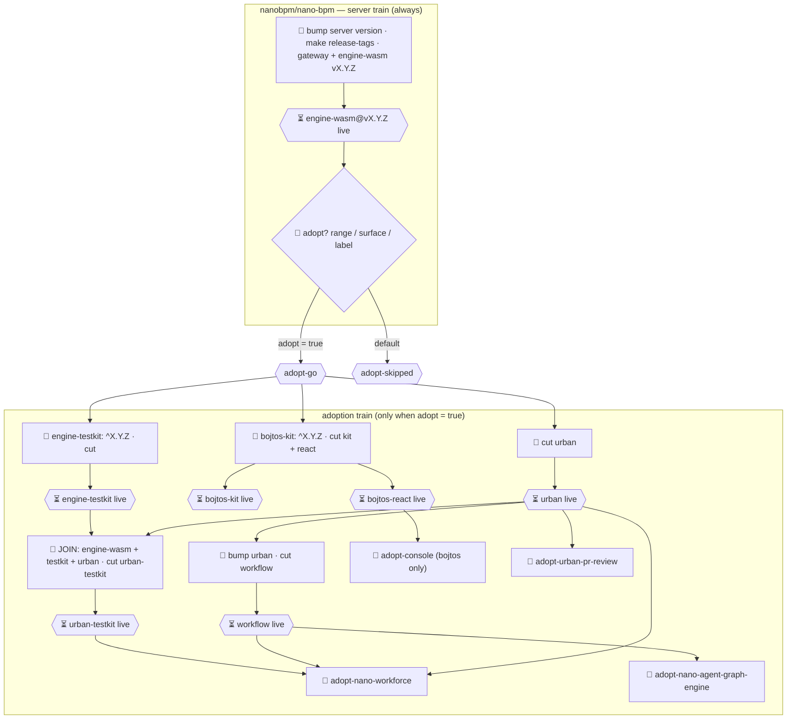

# wasm-engine-release-graph

A **reusable, version-controlled [Nano Workforce](https://nanobpm.io) delivery graph** for a nano
release: it cuts the **server release** (the gateway binary and, from the same `v*` tag,
`@nanobpm/engine-wasm`), then decides whether the downstream ecosystem needs to adopt it, and only
if so runs the **adoption train**. That train bumps each downstream dependency in topological order,
and every cross-repo publish is gated on its upstream actually being live on the registry.

This repo is **the process, as data**. The graph is authored once
([`graph/release-graph.json`](graph/release-graph.json)), checked in, reviewed like code, and
re-run every release — as opposed to Nano Workforce's built-in processes (merge-loop, convergence,
plan-fanout) or its *one-shot* ad-hoc delivery graphs. It is the reference example of a
**user-supplied, repeating delivery graph**.

> **Requires https://github.com/nanobpm/nano-workforce/issues/1083.** The conditional adoption
> train contains parallel forks/joins and nested splits, which the delivery-graph validator does not
> accept yet. `npm run check` passes (shape); `d8ctl nwf graph compile` will fail until that ships.

## Why this exists

The nano ecosystem roots in one Rust crate and fans out through **three different release systems**:

| Train | Repo | Mechanism | Publishes |
|---|---|---|---|
| server | `nanobpm/nano-bpm` | version-bump PR + `make release-tags` (see its RELEASE.md; **OIDC**) | gateway binary (→ c8ctl-plugin-nano), ProcessOS, `engine-wasm` (same version, same `v*` tag), `engine-testkit` |
| bojtos | `nanobpm/bojtos` | semantic-release (kit + react under one tag) | `bojtos-kit`, `bojtos-react` |
| urban | `nanobpm/nano-ide` | release-please (CI token) | `urban`, `workflow`, `urban-testkit` |
| apps | `nano-workforce`, `console`, `urban-pr-review`, `nano-agent-graph-engine` | semantic-release / release-please / adopt PRs | the sinks |

All three trains publish via **OIDC / CI tokens** — no interactive OTP — so every publish is
automatable. The graph is therefore **fully agentic**; the human-in-the-loop is the single
approval-token gate at dispatch (below), not a per-publish stop.

### One engine version (nano-bpm#1872)

Since https://github.com/nanobpm/nano-bpm/pull/1872, `@nanobpm/engine-wasm` has **no version or
train of its own**: it is stamped from `server/Cargo.toml` and published from the server's `v*` tag
(`server vX.Y.Z` ⇔ `engine-wasm X.Y.Z`). So there is one release event, and everything else is
*adoption* of it. That is why this is one graph rather than an engine graph plus a downstream graph.

Three consequences shape the graph:

- **The server jumps to v0.12.0.** The retired engine-wasm train already published 0.1.0–0.11.2,
  while the server was at v0.0.28. Publishing engine-wasm 0.0.29 would be legal but *lower* than
  0.11.2: `^0.11.2` consumers never see it, "highest version" resolution and Renovate/`npm outdated`
  keep pointing at 0.11.2, and lower numbers like 0.2.0 collide with versions npm already holds. So
  the first coupled release is **v0.12.0** (server and engine-wasm), and versions only go up from
  there. `srv-release` enforces the floor: the next version must be above the highest published
  engine-wasm.
- **Ranges are caret on the minor.** From 0.12.0 on, `^0.12.0` = `~0.12.0` = `>=0.12.0 <0.13.0`,
  so a server patch flows through to consumers without any adopt PR. (On `0.0.x`, `^0.0.29`
  would have admitted *only* `0.0.29`, another reason not to stay there.) The first release
  always adopts, since `^0.11.2` doesn't admit 0.12.0.
- **Adoption is conditional.** Because the ranges absorb patches, most server releases need
  nothing downstream. The `adopt-decision` node runs the adoption train only when a consumer's
  range doesn't admit the new version, the engine-wasm public surface (TS/JS API, DTOs, FFI ABI)
  changed, or a PR in the release carries the `adopt-downstream` label.

## Prior art / lineage

This is the realisation of a design its author first sketched in 2020:
[*Complex multi-repo builds with GitHub Actions and Camunda Cloud*](https://medium.com/@sitapati/complex-multi-repo-builds-with-github-actions-and-camunda-cloud-fa8e4c7abd26).
That article named the exact problem this repo solves — *"how do I trigger a test run for downstream
dependent packages when I publish a new image of the core API?"* — and rejected the exact
anti-pattern (`repository_dispatch` webhooks: *"the rabbit hole of peer-to-peer choreography, with an
attendant loss of visibility"*) in favour of a single orchestrating model: **"executable
documentation of the system architecture that cannot go out of date."** That phrase is precisely
what [`graph/release-graph.json`](graph/release-graph.json) is.

What changed in six years is the substrate. The 2020 version bridged GitHub to **Camunda Cloud /
Zeebe** over REST, with a bespoke [Zeebe GitHub Action](https://github.com/jwulf/zeebe-action) and
message-correlation on a `buildid`. Here the orchestrator is a `DeliveryGraph` compiled to native
BPMN running on the in-repo **WASM engine** — `agent` nodes in place of `repository_dispatch`
callbacks, `wait` / npm-readiness probes in place of correlation messages, and the model itself is
the versioned deliverable rather than a Modeler diagram that drifts. Same thesis; no external cloud,
no REST bridge, no stale drawing.

## The graph

12 `agent` (release, adoption decision, adopt work) · 14 `wait` (server-live, branch, npm
registry-propagation and range-adoption gates) · 3 `human` (console adopt review / missing-surface
escalation). The overview below is simplified; the authoritative rendered view is
[`docs/graph.mmd`](docs/graph.mmd) (derived from the graph):



### Node kinds

- **🤖 `agent`** — a `senior:*` worker job does the work (cut the server release, decide on
  adoption, bump a downstream range, build + test, cut/publish via OIDC, or open the downstream
  adopt PR). Side-effecting, except `adopt-decision`, which is read-only and emits `adopt: boolean`.
- **⏳ `wait`** — a durable readiness probe: `srv-live` checks that `@nanobpm/engine-wasm` is on npm
  at the latest server release's version; the `*-live` `npm` probes block the next cut until the
  upstream is resolvable on the registry (the propagation-lag guard) and emit an `artifact` fact;
  the `*-adopted` command probes prove each consumer's range resolves forward. `adopt-go` and
  `adopt-skipped` are pass-through branch markers.
- **🧑 `human`** — scheduled user tasks, answerable by a human *or* an agent: reviewing the console
  adopt PR, and escalating when the console needs an upstream API that doesn't exist yet (Mode D).

Every `agent`/`connector` node is a **side effect**, so the whole graph is **parked at approval**
until dispatched with its content-addressed approval token (see below) — that single gate is the
human-in-the-loop.

## Working with the graph

```bash
npm install
npm run schema     # (re)derive schema/ from nano-workforce's openapi.yaml (single source of truth)
npm run validate   # offline SHAPE gate (Ajv) — structure only
npm run render     # regenerate docs/graph.mmd from the graph
npm run check      # validate + assert docs/graph.mmd is up to date (what CI runs)
```

The offline shape-gate is **necessary, not sufficient**: the authoritative **semantic** validation
(acyclic DAG, no dangling edges, every `<node>.<fact>` endpoint resolves) lives in Nano Workforce's
`validateDeliveryGraph` and runs at dispatch. To exercise it — and to preview/launch the run —
point at a running Merlin instance:

```bash
MERLIN_URL=http://127.0.0.1:3000 npm run preview     # validate + compile + show diagram/stops/effects (no side effects)
MERLIN_URL=http://127.0.0.1:3000 npm run dispatch    # preview, stage, then launch with the approval token
```

`preview` posts to `actions/delivery-graph/preview`, which persists nothing. `dispatch` previews, then
stages the same graph through `actions/compile-delivery-graph` (refusing if the staged digest differs
from the previewed one), then posts the digest to `actions/delivery-graph/dispatch` as the approval.
A re-dispatch with the same graph is idempotent (short-circuits onto the in-flight run).

Point `MERLIN_URL` at nwf itself (port 3000, e.g. through `ssh -L 3000:localhost:3000 merlin.local`),
not at the gateway on 8080: laying out this graph takes minutes, and the gateway's proxy gives up
after 30 s with a 502.

## Single source of truth / no drift

- [`graph/release-graph.json`](graph/release-graph.json) is the **only** hand-authored artifact.
- [`schema/delivery-graph.schema.json`](schema/delivery-graph.schema.json) and
  [`docs/graph.mmd`](docs/graph.mmd) are **derived** — regenerated by `scripts/extract-schema.mjs`
  (from nano-workforce's `openapi.yaml`) and `scripts/render.mjs` respectively. CI git-diffs them,
  so a stale artifact fails the build instead of drifting.
- The schema is *extracted* from the upstream contract, never hand-copied — when the DeliveryGraph
  vocabulary moves, re-run `npm run schema` and commit.

## License

MIT — see [LICENSE](LICENSE).
